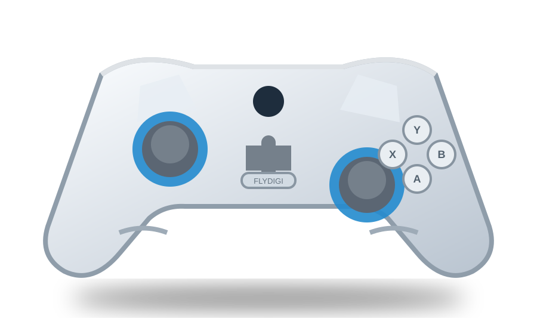
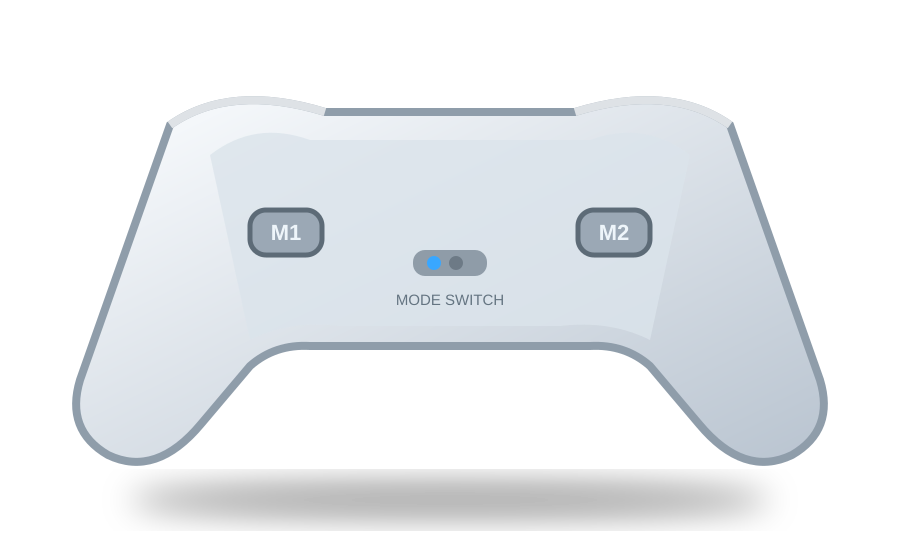

<!--
Speaker split:
  Speaker 1: slides 1–5, about 4 minutes.
  Speaker 2: slides 6–10, about 4 minutes.
-->

# FLYDIGI **Direwolf**

CONTROL THE MOMENT

  
Игра начинается с ощущения.

  
Универсальный контроллер для тех, кто хочет играть точнее, дольше и без лишних ограничений.

  
PCMobileNintendo Switch

  

<!--
SPEAKER 1 — 35 sec
Сегодня мы представляем FLYDIGI Direwolf — контроллер, который превращает обычную игру в более точный и комфортный опыт. Мы покажем, почему это не просто аксессуар, а удобный инструмент для разных платформ и жанров.
-->

---

# Знакомая форма. **Другой уровень контроля.**

  
⌁

  <h3>Эргономика</h3>
  
Симметричная форма и текстурированные рукоятки помогают играть дольше без лишнего напряжения.

  
◉

  <h3>Точность</h3>
  
Два аналоговых стика и полноценная крестовина дают контроль и в шутерах, и в гонках, и в файтингах.

  
↯

  <h3>Свобода</h3>
  
Проводное и беспроводное подключение — выбирайте стабильность или мобильность под задачу.

01 / WHY IT MATTERS

<!--
SPEAKER 1 — 45 sec
Главная проблема обычного управления — компромисс. Клавиатура даёт много кнопок, но не всегда комфортна. Сенсорный экран удобен, но ему не хватает тактильной точности. Direwolf занимает середину: привычная раскладка, физические кнопки и удобный хват.
-->

---

# Один контроллер — **несколько игровых миров**

  

    
01

<b>PC</b>
низкая задержка через адаптер или кабель

  

  

    
02

<b>Телефон / планшет</b>
Bluetooth для игр в дороге

  

  

    
03

<b>Nintendo Switch</b>
отдельный режим подключения

  

  
ONE DEVICE / MANY PLATFORMS

  
Не покупайте три разных контроллера.

  
Переключайтесь между сценариями, а не между аксессуарами.

<!--
SPEAKER 1 — 50 sec
Direwolf полезен не только дома за компьютером. По данным инструкции линейки Direwolf, предусмотрены режимы для PC, Android, iOS и Switch. Это особенно удобно для тех, кто играет на нескольких устройствах и не хочет каждый раз привыкать к новой раскладке.
-->

---

# Детали, которые чувствуются **в игре**

  
01 / STICKS

  <h2 class="text-2xl font-bold mt-3">Два стика с текстурой</h2>
  
Синий акцент помогает быстро ориентироваться, а рельефная поверхность не даёт пальцу соскользнуть в напряжённый момент.

  
02 / D-PAD

  <h2 class="text-2xl font-bold mt-3">Гибридная крестовина</h2>
  
Подходит для диагональных движений, меню, платформеров и точных комбинаций.

  
03 / TRIGGERS

  <h2 class="text-2xl font-bold mt-3">Большие плечевые кнопки</h2>
  
Указательные пальцы остаются на управлении, а остальные кнопки доступны без смены хвата.

  
04 / USB-C

  <h2 class="text-2xl font-bold mt-3">Современная зарядка</h2>
  
Один распространённый кабель — для зарядки и проводной игры.

<!--
SPEAKER 1 — 55 sec
Реклама работает не только через список характеристик. Важно, что человек ощущает руками. Здесь есть текстурированные стики, крупные плечевые кнопки, гибридная крестовина и USB-C. Это детали, которые заметны уже в первой игре.
-->

---

# **M1 / M2** — преимущество, которое остаётся за спиной

  

  

  
BACK CONTROL

  
Побеждает не тот, кто нажимает больше. А тот, кто тратит меньше времени на лишние движения.

  

    
<b>Шутеры:</b> прыжок или приседание без отпускания стика.

    
<b>Гонки:</b> быстрый доступ к дополнительной функции.

    
<b>Игры с комбинациями:</b> назначьте действие под себя.

  

<!--
SPEAKER 1 — 55 sec
Ключевая рекламная фишка — две кнопки на задней стороне. Их можно использовать для часто повторяющихся действий. В шутере это может быть прыжок, в гонке — дополнительная функция, а в любой игре — команда, до которой обычно приходится тянуться большим пальцем. На этом заканчивается первая часть: форма, совместимость и контроль.
-->

---

# Не просто контроллер. **Игровой апгрейд.**

  
PART 2 / THE EXPERIENCE

  
Почувствуйте разницу.

  
Теперь посмотрим, как Direwolf превращает функции в реальные преимущества.

  
4:00

  
минуты до финального выбора

  
Комфорт · скорость · универсальность

<!--
SPEAKER 2 — 25 sec
До этого мы говорили о том, что находится внутри и снаружи контроллера. Теперь — о результате для пользователя: как он ощущается в реальной игре и почему за него стоит заплатить.
-->

---

# Три сценария, где Direwolf раскрывается

  
⚡

  
ACTION

  <h2 class="text-2xl font-bold mt-3">Шутеры</h2>
  
Стик отвечает за движение и камеру, триггеры — за точное действие, M1/M2 — за команды без потери контроля.

  
◒

  
RACING

  <h2 class="text-2xl font-bold mt-3">Гонки</h2>
  
Плавное управление стиками и удобные триггеры дают более естественное ощущение газа, тормоза и поворота.

  
✦

  
CASUAL

  <h2 class="text-2xl font-bold mt-3">Игры с друзьями</h2>
  
Подключили — и играете. Подходит для быстрых матчей, платформеров и совместного отдыха.

<!--
SPEAKER 2 — 50 sec
У Direwolf есть три сильных сценария. В экшен-играх важны быстрые реакции и задние кнопки. В гонках — плавность стиков и триггеров. В играх с друзьями — простое подключение и привычная раскладка. Один продукт закрывает разные потребности.
-->

---

# Настройте управление **под себя**

  
FLYDIGI SPACE STATION

  
Контроллер не диктует стиль игры.

  

    
→ переназначьте кнопки

    
→ настройте дополнительные команды

    
→ сохраните удобный профиль

  

  
YOUR_PROFILE.json

  

    { 
    &nbsp;&nbsp;"mode": "competitive", 
    &nbsp;&nbsp;"back_left": "jump", 
    &nbsp;&nbsp;"back_right": "crouch", 
    &nbsp;&nbsp;"platform": "PC" 
    }
  

<!--
SPEAKER 2 — 55 sec
Ещё одно преимущество — настройка через Flydigi Space Station. Можно переназначать кнопки и сохранять собственный профиль. Поэтому один и тот же контроллер может быть настроен для соревновательной игры, гонок или просто удобного управления.
-->

---

# Честный выбор: что важно знать

  
Сильные стороны

  

    
✓ удобная симметричная форма

    
✓ несколько способов подключения

    
✓ две задние переназначаемые кнопки

    
✓ USB-C и поддержка нескольких платформ

  

  
Перед покупкой

  

    
! точная ревизия зависит от модели

    
! часть функций требует приложения

    
! совместимость лучше проверить под свою игру

    
! это не замена профессиональному симулятору

  

<!--
SPEAKER 2 — 50 sec
Хорошая реклама должна быть честной. Direwolf силён универсальностью, задними кнопками и удобством. Но точные функции зависят от ревизии, поэтому перед покупкой стоит проверить модель и совместимость с конкретной игрой. Для обычного PC и кроссплатформенной игры это разумный апгрейд.
-->

---

# Наш вердикт

  
FINAL SCORE

  
Играй. Настраивай. Побеждай.

  
FLYDIGI Direwolf — выбор для игрока, которому нужен комфорт консоли и гибкость современного устройства.

  
4.5/5

  

    
Комфорт★★★★★

    
Универсальность★★★★★

    
Настройка★★★★☆

    
Цена / возможности★★★★★

  

<!--
SPEAKER 2 — 55 sec
Наш итог: Direwolf — это не обещание выиграть за вас. Это инструмент, который убирает лишние движения, даёт удобный хват и работает в разных игровых сценариях. Если нужен один белый универсальный контроллер для PC, мобильных устройств и Switch, это сильный кандидат.
-->

---

# Спасибо за внимание

  
QUESTIONS?

  
Попробуйте сами.

  
Лучший способ оценить контроллер — взять его в руки и сыграть один раунд.

  Источники: flydigi.com · руководство Direwolf · visual identification by provided photos

<!--
SPEAKER 2 — 40 sec
Спасибо за внимание. Мы готовы показать контроллер вживую и ответить на вопросы.
-->
